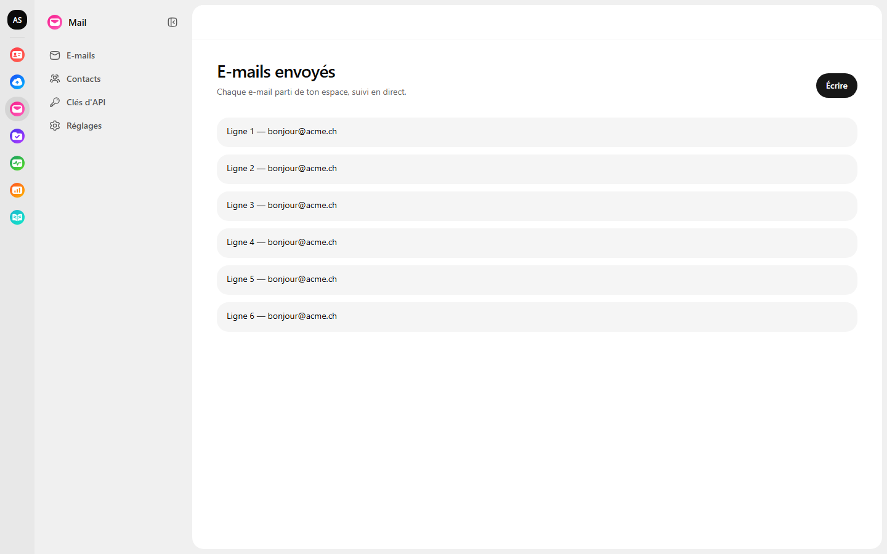
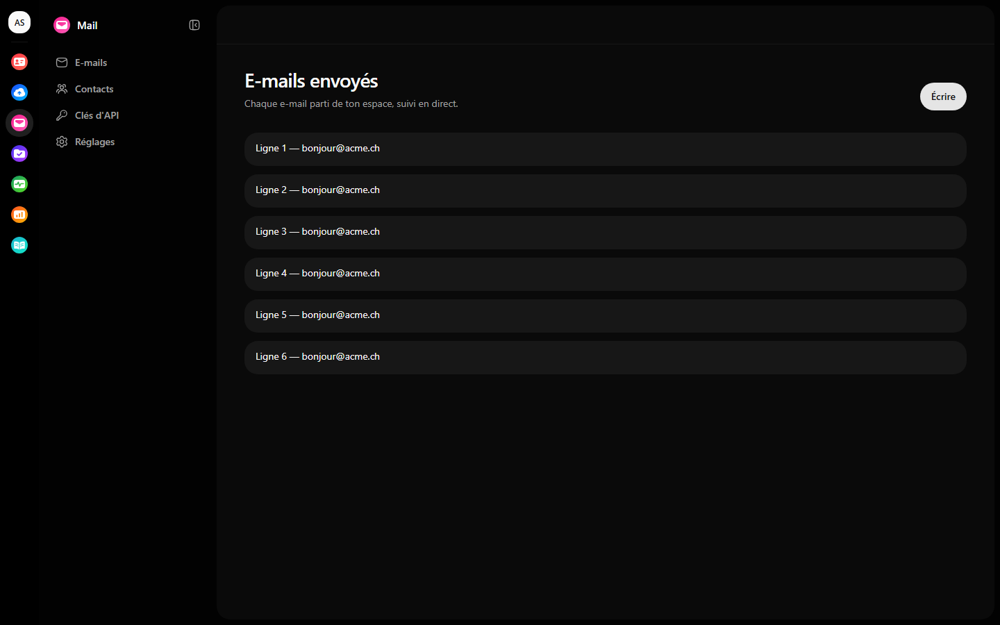
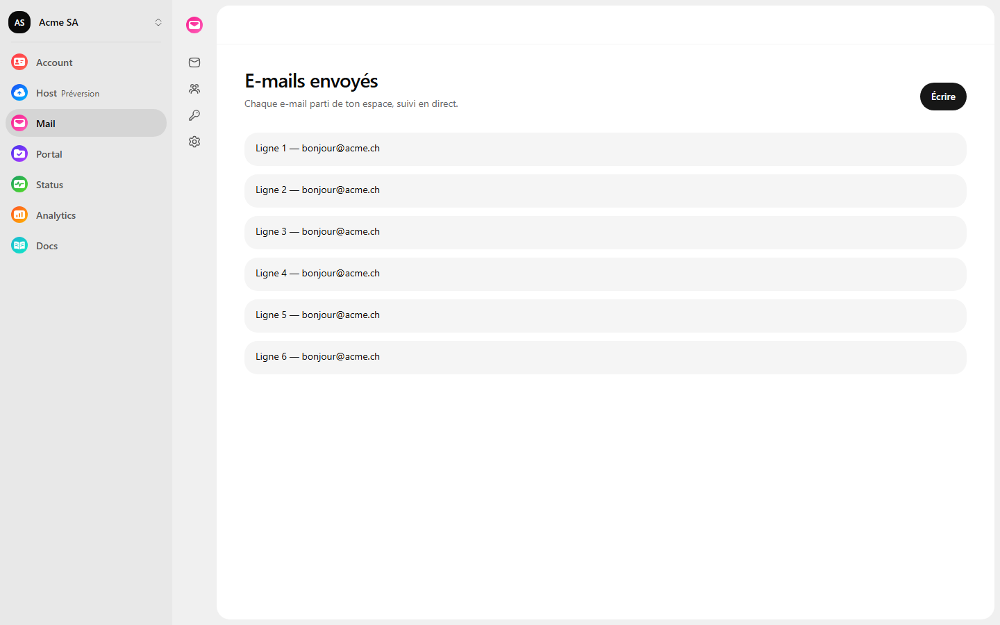
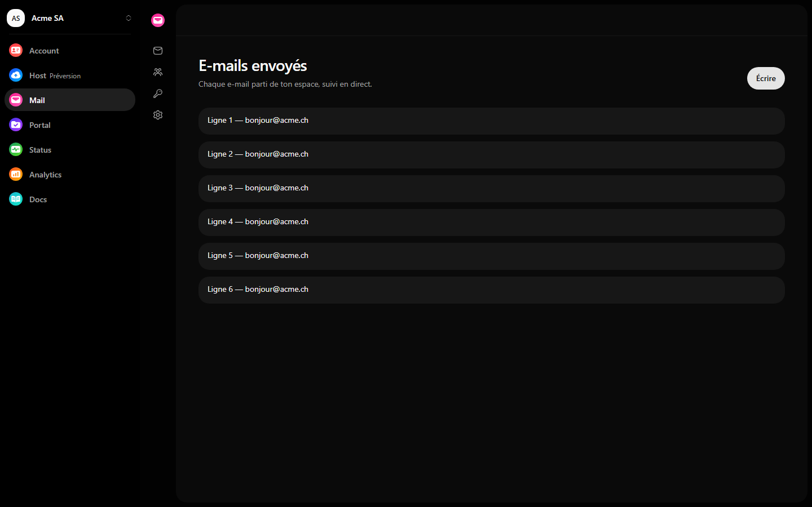
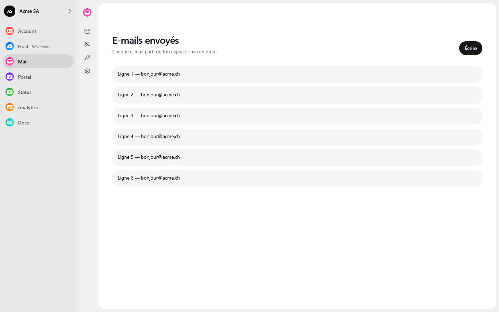
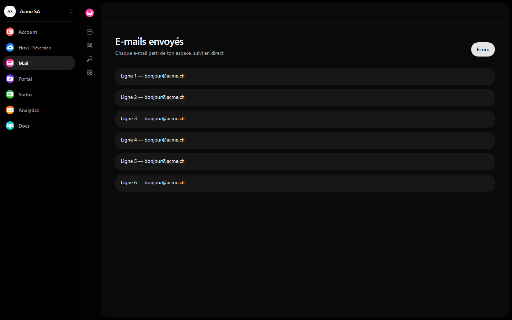
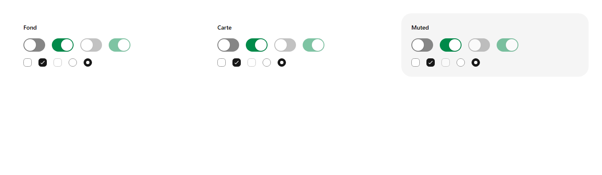
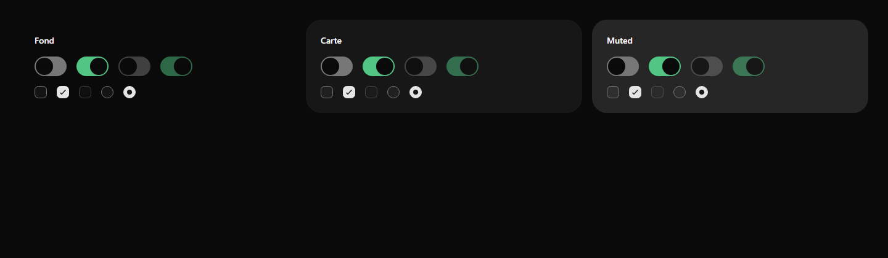
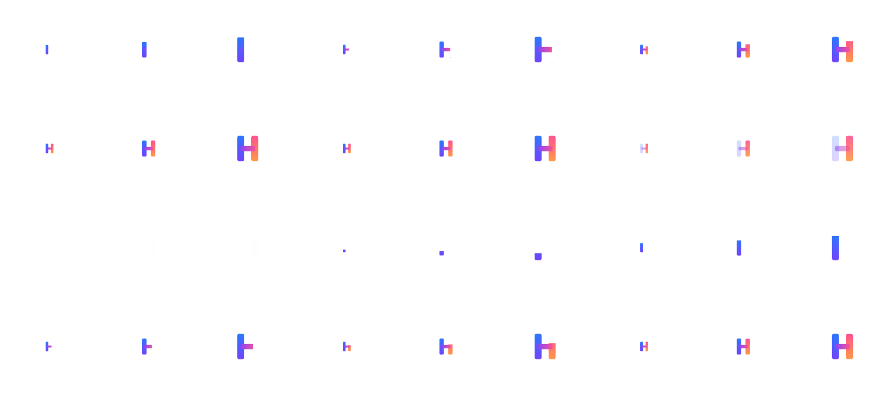
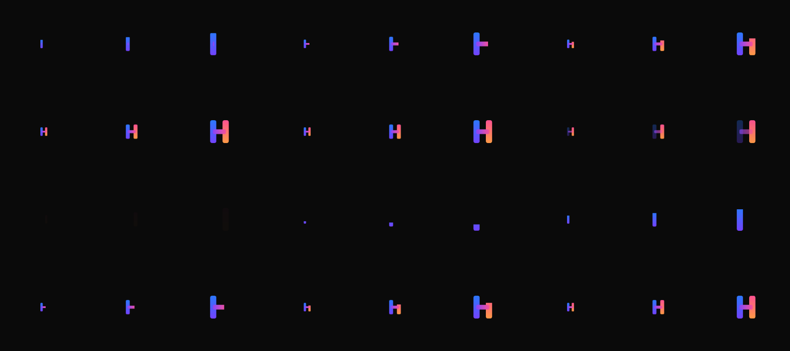

# 0011. Barre des produits et marque du produit dans `AppShell`

## Contexte

Passer d'un produit de la famille à un autre demandait d'ouvrir le menu de l'avatar, en bas de la barre latérale. Les sept produits partagent la même coque (`AppShell`, ADR 0006) et la même entrée (`/auth/hgdc`, ADR 0010) : une barre commune à gauche, à la manière de kSuite, rend la famille visible et le changement immédiat.

Le bouton qui réduit la barre latérale posait deux problèmes. Il était plus petit que les entrées de navigation (32 px contre 36 px de haut), et en rail il passait sous le sélecteur d'organisation, en tête de colonne : la navigation descendait d'une ligne et le bouton n'avait plus d'endroit stable. Ses icônes étaient en plus inversées : les noms de Hugeicons décrivent l'état du panneau, pas le geste.

## Décision

- **Barre des produits** à l'extrême gauche, sur ordinateur seulement (`lg`, le seuil où la coque passe du tiroir à la colonne ; sur téléphone, les produits restent dans le menu de l'avatar). 56 px de large. De haut en bas : le sélecteur d'organisation, Account, puis les pastilles des produits ouverts du catalogue. Account reste hors du catalogue (`HGDC_ACCOUNT`, hors de `HGDC_PRODUCTS`) mais passe en tête : en bas de la barre, personne ne le voyait (révision du 2026-10-16). Pas d'aide en bas : la coque n'en a pas, chaque produit garde ses liens d'aide dans le pied de sa barre.
- **Survol** (révisé le 2026-10-16) : après 150 ms d'intention, la barre s'élargit et écrit le nom de chaque produit en police de titre. Elle ne recouvre plus la page : la barre latérale du produit se plie en rail le temps du survol (`data-rail-peek` sur la coque, lu par la variante `rail:`), et la barre prend exactement la place libérée, 248 px (56 + 256 = 248 + 64) : la page ne bouge pas. Si la barre latérale est déjà pliée par la personne (variante `folded:`), la barre s'élargit à 220 px et pousse la page. Tout revient dès que la souris sort, sauf si un menu ouvert depuis la barre l'est encore (sélecteur d'organisation, ou tout déclencheur `aria-expanded="true"` qu'elle contient) : la souris qui va dans le menu ne replie pas la barre sous elle ; elle se replie à la fermeture du menu si la souris n'est plus dessus (révisé le 2026-10-16). Les deux largeurs suivent la même transition (200 ms, `ease-ios`), interrompue et reprise sans saut ; aucune sous `prefers-reduced-motion`. Le pliage de `Ctrl+B` passe à la même durée. Au clavier, le focus d'un lien l'ouvre (`:focus-visible` après une touche, jamais après un clic ni quand le focus revient au déclencheur d'un menu ouvert à la souris), `Échap` la referme.
- **Couleurs** : fond `--shell-rail`, un cran sous la coque. Produit courant en teinte (`--shell-active`, `aria-current="page"`), jamais de contour ni d'accent.
- **Liens** : `https://<mot>.hgdc.ch/auth/hgdc?refresh=1&next=/` pour chaque produit (relecture des organisations au passage, ADR 0013), la racine d'Account (ou `accountHref` en développement), `/` pour le produit courant. Le catalogue (`productRailEntries`) fait foi : un produit « bientôt » n'y apparaît pas.
- **Marque du produit** en tête de la barre latérale (`product`, obligatoire) : pastille et « HGDC <mot> ». Le sélecteur d'organisation quitte la barre latérale pour la barre des produits (`organization`). Il s'y rend compact par un contexte (`ShellPlacementContext`), sans variante à passer.
- **Plier et déplier** : le bouton fait 40 × 36 px, la boîte d'une entrée en rail, icône de 18 px. Dépliée, il reste à droite de la marque. En rail, il ne descend pas : la pastille du produit **devient** le bouton « Déplier » au survol de la barre ou au focus (fondu croisé des deux icônes au même endroit, `aria-label`, infobulle avec le raccourci). Les deux états sont dans la page, choisis par la variante CSS `rail:`, donc justes dès la première peinture. `Ctrl+B` inchangé.
- **`productRail={false}`** coupe la barre des produits pour un écran qui ne doit pas l'avoir ; l'organisation revient alors sous la marque.

## Conséquences

- `sidebarHeader` disparaît d'`AppShell` au profit de `product` et `organization` : chaque produit l'adopte en montant `@hgdc/ui` (version mineure, le kit est en 0.x).
- La barre des produits mène aux autres produits par leur entrée commune : un produit doit monter `/auth/hgdc` (déjà le cas des sept, ADR 0010).
- Sur tablette tactile au-delà de `lg`, la barre ne s'élargit pas (pas de survol) : les pastilles restent cliquables, leur nom est lu par les lecteurs d'écran.
- **Chargement d'une page** : `FamilyLoader` (`@hgdc/ui/family-loader`), le H tricolore qui se construit pièce par pièce, tient puis s'efface, en boucle (CSS seul, environ 1,8 s). Visible après 200 ms, place réservée dès le départ ; mouvement réduit : le H entier respire. Pour une route ou une page entière (`pendingComponent`, `FamilyLoader page`) ; `Spinner` reste la règle dans un bouton ou une ligne.

## Captures (1440 px, 2026-10-16)

|                                                             | Clair                                       | Sombre                                     |
| ----------------------------------------------------------- | ------------------------------------------- | ------------------------------------------ |
| Barre fermée                                                |           |           |
| Survol, barre latérale dépliée                              |  |  |
| Survol, barre latérale pliée                                |    |    |
| Contrôles éteints, allumés, désactivés (fond, carte, muted) |            |            |
| `FamilyLoader`, un cycle en 12 images (150 ms)              |       |       |
